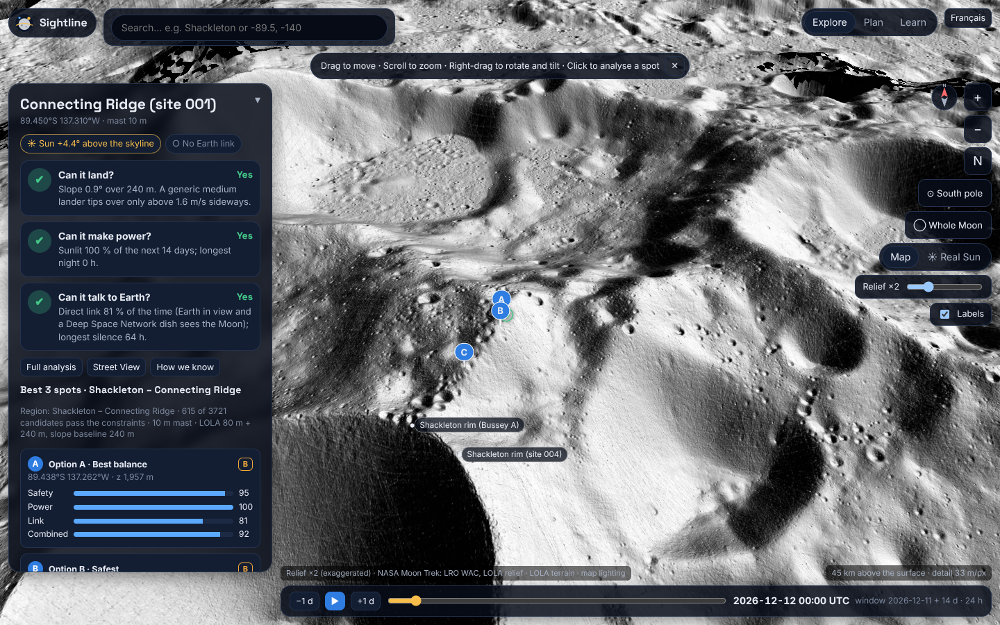
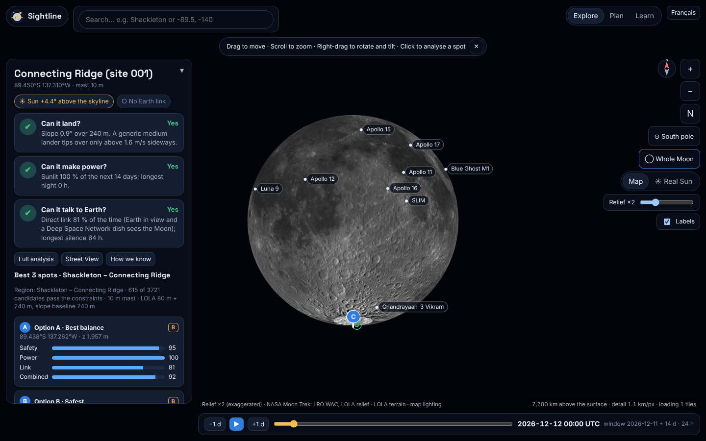
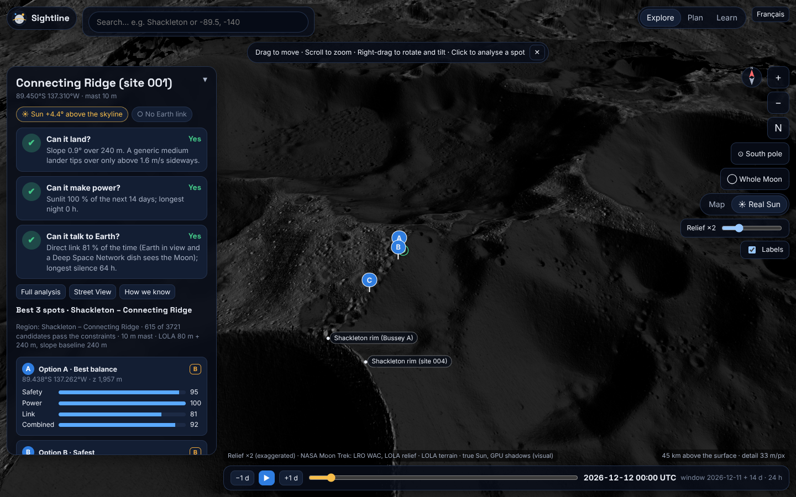
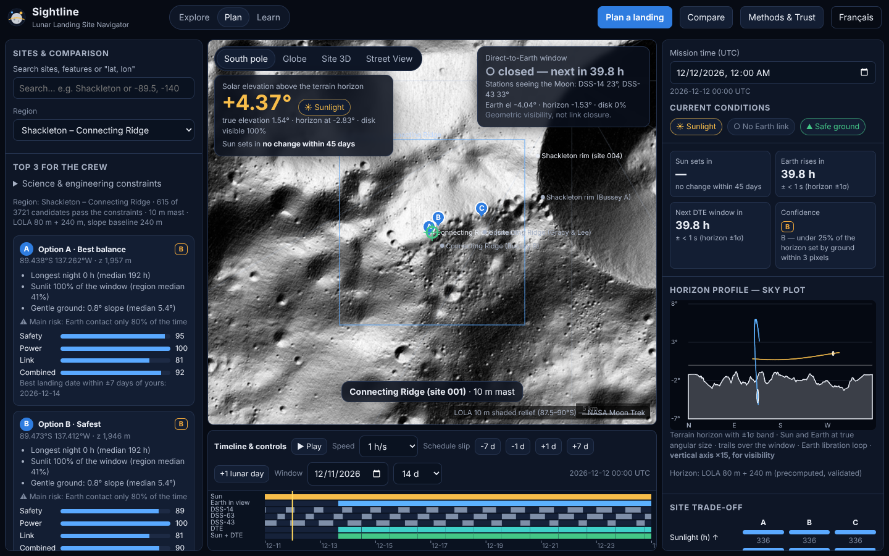
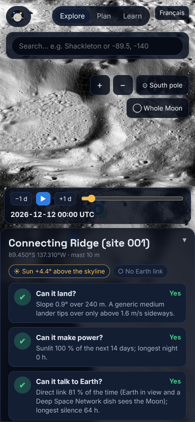

# Sightline — Lunar Landing Site Navigator

NASA Space Apps Challenge 2026 · challenge "Lunar Landing Site Navigator".

*Pick a region and a date. In seconds, get the three best places to land near the lunar south pole — safe to touch
down, powered by the Sun, in contact with Earth — and see why.*

**Live site**: https://w14m3.github.io/NASA_SpaceApps2026/ (GitHub Pages — the owner must enable Pages once:
Settings → Pages → Source: GitHub Actions; CI already builds and uploads the site on every push to `main`).



| Whole Moon (zoom out) | Real Sun and shadows | Plan mode (expert workbench) | Phone (390 px) |
|---|---|---|---|
|  |  |  |  |

## What it does

- **Explore (default)** — a full-screen 3D Moon you move like a map: drag, scroll or pinch to zoom toward the cursor,
  right-drag to rotate and tilt. NASA Moon Trek imagery sharpens as you zoom (LRO WAC worldwide; at the south pole
  LOLA shaded relief down to 33 m per pixel on real 3D LOLA terrain), with flat "Map" lighting or the true Sun and
  its shadows. One card answers *Can it land? Can it make power? Can it talk to Earth?* in plain words and lists the
  best three spots; click anywhere to analyse that spot. **Plan** mode keeps the full expert workbench below.
- **Answer first** — opens on a computed scenario with the Top 3 already ranked out of 3,721 candidates per region:
  "Safest", "Most sunlight", "Best Earth link", "Best balance", each with three reasons, the main risk, a confidence
  grade and the best landing date in the window. "Choose this site" produces a printable **Mission Brief**.
- **Moon Maps** — south-pole map with computed layers (mean illumination, longest night, zero-illumination cells,
  Earth visibility, direct-to-Earth, slope, viability index, mast gain, live lighting, Sun/Earth rays), search by name or
  "lat, lon", click anywhere to analyse; 3D globe with NASA Moon Trek imagery lit by the true Sun; **Site 3D** with
  real-time shadows; **Moon Street View** with the Sun and Earth at true angular size.
- **Power** — layouts and mast heights, optimiser and headline versus a fair baseline (best fixed vertical panel at
  2 m), storage and a battery survival timeline. Illumination is kept separate from electrical power.
- **Earth link** — DSN Goldstone, Madrid, Canberra (+ your own station, form in Plan mode), adjustable minimum elevation, direct-to-Earth windows and countdowns, an optional link budget from your own hardware values, pointing
  envelope, path loss per band, solar-interference flag. Geometric feasibility, not link closure.
- **Safety** — plane-fit slope at a stated baseline, roughness, tip-over margin and critical sideways speed, seeded
  landing-ellipse Monte Carlo. Screening estimates with generic, illustrative lander presets.
- **Why small changes matter** — Who blocks the Sun, illumination compass ("snap to best within 500 m"), Moon
  Directions, 12-lunation season heatmap, site-date scenario comparison, mission replay (IM-1, IM-2, Chandrayaan-3).
- **For everyone** — Explore / Plan / Learn modes, guided tour, glossary, "Land it!" game, English and French,
  keyboard operable, colour-blind-safe ramps, installable offline PWA.

## Quick start (30 seconds)

```bash
npm ci
```

```bash
npm run dev
```

Open http://localhost:5173. All data artifacts are committed in `web/public/data/`; no download is needed to run.

Full quality gate (lint, typecheck, Vitest, offline pytest, build, Playwright e2e, objective statuses):

```bash
npm run verify
```

Rebuild the artifacts from their inputs and check the hashes (V14): `python pipeline/scripts/fetch_de421.py`, then
`node scripts/rebuild-check.mjs` (add `--candidates` to rebuild the candidate grids, ~12 min).

## Architecture

```
pipeline/   Python: SPICE (spiceypy) and an independent DE421 reader (LT+S, PA→ME), ERFA time scales, Chebyshev fits,
            artifact builders (ephemeris, DEM, sites, fixtures), pytest
web/src/core/   framework-free TypeScript science: ephemeris, topocentric geometry, horizon masks, disk visibility,
            events, energy, stations/link, safety, thermal, Top 3, who-blocks, traverse (+ Vitest validation tests)
web/src/workers/  Web Worker running the core (live horizons, analyses, ranking, layers) off the main thread
web/src/ui/     React UI (map, globe, Site 3D, Street View, workbench, timeline, compare, brief, trust, learn)
web/scripts/    Node builders that import the core: candidate grids, validation of the grids, default window
data/validation/  recorded test results (statuses are generated, never typed)
reference/v1/   earlier validated implementation, read-only oracle
```

The browser never calls SPICE or Horizons: the pipeline compresses the apparent Sun and Earth vectors (Moon-centred,
MOON_ME) and the geocentric Moon into Chebyshev polynomials whose error is measured at build time.

## Trust

See [`docs/VALIDATION.md`](docs/VALIDATION.md) (generated) and the in-app **Methods & Trust** page. Highlights: browser
ephemeris vs rigorous SPICE 2.7e-5°; vs 2,012 cached JPL Horizons rows 2.7e-5°; DSN Moon elevation vs Horizons 0.0005°;
curated horizon masks recomputed from LOLA 80 m match the reference to 0.001°; Apollo 11 touchdown Sun elevation
10.703° (Horizons 10.703°); horizon algorithm identical to the validated v1 code on the same DEM; event times within
0.5 s of a 1 s scan; energy within 3.6e-6 % of a one-minute reference over a year; station geometry within 0.0022° of
an independent astropy chain; Top 3 deterministic, feasible and ≥ 1 km apart; A* identical to Dijkstra.
Equations and constants: [`docs/METHODS.md`](docs/METHODS.md).

## Limits

- Terrain: LOLA 80 m + 240 m (PGDA product 90). Live custom sites outside the four hero-region windows use 240 m
  (screening resolution; horizons can differ by ~3°). No 5 m DEM was reachable: lander-scale relief is not resolved.
- Not modelled: reflected light from terrain, thermal and dust effects, lander self-shadowing, antenna patterns,
  leg dynamics, soil failure, rocks smaller than a pixel. Several literature coordinates are flagged "unverified".

## Docs

[METHODS](docs/METHODS.md) · [VALIDATION](docs/VALIDATION.md) · [TRACEABILITY](docs/TRACEABILITY.md) ·
[OBJECTIVES](docs/OBJECTIVES.md) · [RESOURCES](docs/RESOURCES.md) · [DECISIONS](docs/DECISIONS.md) ·
[DATA_PROVENANCE](docs/DATA_PROVENANCE.md) · [REFERENCE_AUDIT](docs/REFERENCE_AUDIT.md) · [PRODUCT](docs/PRODUCT.md) ·
[SUBMISSION](docs/SUBMISSION.md) · [DEMO_SCRIPT](docs/DEMO_SCRIPT.md) · [PITCH](docs/PITCH.md) · [WORKLOG](docs/WORKLOG.md)

Build contracts: [`docs/MASTER_PROMPT_V3.md`](docs/MASTER_PROMPT_V3.md) (Claude Code), [`AGENTS.md`](AGENTS.md) +
[`docs/MASTER_PROMPT_CODEX.md`](docs/MASTER_PROMPT_CODEX.md) (Codex).

## Credits and licence

Code: MIT. Data: NASA LRO/LOLA — GSFC Planetary Geodesy Data Archive, product 90 (Barker et al. 2023, PSJ 4, 183);
LRO WAC mosaic — NASA/GSFC/Arizona State University via NASA Moon Trek; JPL/NAIF SPICE and JPL DE421/DE440
ephemerides; JPL Horizons (validation); IERS Earth orientation; DSN station coordinates via NAIF; USGS and the Canadian
Space Agency (challenge resources). Site coordinates carry their sources in `web/public/data/sites.json`.
Sightline is not endorsed by NASA.
